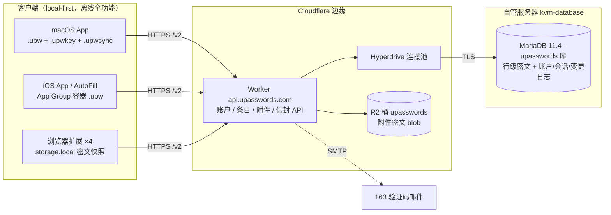
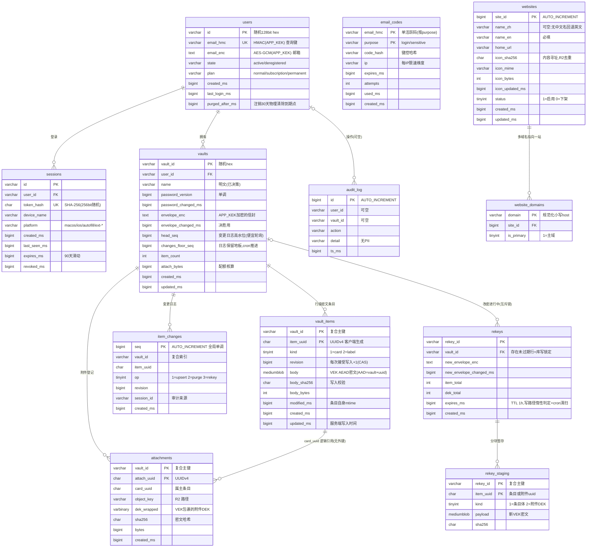
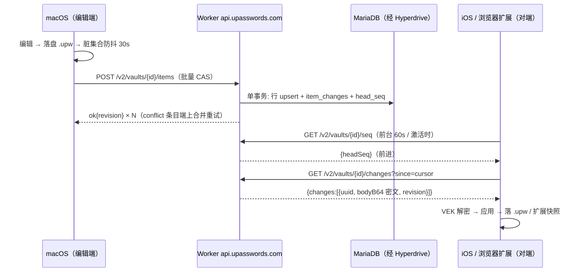

# UPasswords 云同步设计 v7（MariaDB 行级存储 + local-first 同步）

状态：**v7 · 已实施**（Worker /v2 + MariaDB DDL + Core/Persistence/macOS/iOS/扩展客户端，
2026-10-18；云端上线仅剩 Hyperdrive 创建 + deploy，需 `npx wrangler login`）。
取代 v6「库体单文件 + R2 密文副本」方案；
v6 全文见 git 历史（`922e335`）。本文是目标架构的完整规格，实施顺序见 §10。

> 应用处于开发期、未上架：**不承载任何存量用户数据**，所有格式（条目标识、
> 同步协议、API 版本）直接切到 v7 形态，不写兼容迁移。

## 0. 变更总览（v6 → v7）

| 维度 | v6 | v7 |
|---|---|---|
| 密码项数据形态 | R2 单对象密文库体（整文件） | MariaDB **行级密文条目**（每次编辑只改行） |
| 元数据库 | D1 | MariaDB（自管 `kvm-database`，Worker 经 **Hyperdrive** 连接） |
| 同步粒度 | 整库读-改-写 + 双哈希短路 | **条目级增量**（变更日志 + 游标） |
| 附件 | base64 内嵌库体 XML | 元数据随条目体，密文 blob 存 **R2**，路径登记在附件表 |
| 网站名称/图标 | 无目录（运行时抓 favicon / host 作名称） | **全局网站目录表**（中英文名 + R2 内容寻址图标，§4.4） |
| 泄漏密码检测 | HIBP 直查 + 本地动态清单 | **Worker 代理 + 边缘缓存**：统一 `/v2/breach/range` 端点转发 HIBP，HIBP 不再见用户 IP（k-匿名不变，密码不出设备，§4.5） |
| 条目标识 | Int 自增 id（max+1，跨设备可撞） | **UUID v4**（客户端生成，离线无碰撞） |
| 本地文件 | `.upw` 整库密文 + `.upwkey` 信封 | 不变，新增 `.upwsync` 同步游标 sidecar |
| 账户层 / 信封决胜 / 改密轮换 / 零知识 / 拖库三层防御 | —— | **语义全部沿用 v6**（见 §2.2、§3、§6.5） |

用户核心诉求映射：

1. 「更新数据只更新某一行」→ 条目行级 upsert（§4.2 `vault_items`，§6.2）；
2. 「附件进对象存储、路径记录在数据表」→ §4.2 `attachments` + §5 R2 布局；
3. 「本地保留加密库文件、离线可用」→ `.upw` 仍是唯一本地真源（§6.1）；
4. 「低频定时同步 + 编辑后必须同步到各登录平台」→ 编辑防抖即上行 +
   对端短周期游标轮询（§6.4 触发矩阵）；
5. 「关注密码数据安全」→ 零知识行级密文 + AEAD 上下文绑定 + 拖库无害化（§3）。

## 1. 目标与架构



关键性质：

- **零知识（红线）**：MariaDB 与 R2 只见密文与最小元数据（uuid/版本/长度/
  时间戳），服务端永无主密码、VEK、明文条目；条目标题/字段/笔记全部在
  密文体内，服务端搜索能力为零——搜索永远在端上；
- **local-first**：`.upw` 是唯一本地真源，API 不可达时全部本地功能照常；
- **行级增量**：一次编辑 = 一次行 upsert + 一条变更日志，不再整库往返；
- **强一致信封决胜**：改密传播沿用 v6（服务端信封 + changedAt 决胜），
  见 §6.5。

## 2. 业务梳理

### 2.1 角色

| 角色 | 说明 |
|---|---|
| 用户（账户） | 邮箱标识；可拥有多个库（上限沿用 `VAULT_LIMIT_PER_USER=10`） |
| 设备/会话 | macOS、iOS（+AutoFill 同数据源）、浏览器扩展（Safari/Chrome/Edge/Firefox）各自登录为一条会话，会话记录 `platform` |
| 云端 | Worker（无状态 API）+ Hyperdrive + MariaDB（结构化真源）+ R2（附件 blob）+ SMTP（验证码） |

### 2.2 两层凭证（沿用 v6）

| 层 | 凭证 | 用途 |
|---|---|---|
| 账户层（授权） | 邮箱 + 验证码 | 登录新设备、敏感操作（注销/解绑/换绑）；90 天滑动会话，逐设备可撤销 |
| 库层（解密） | (账户 + vault_id) + 库主密码 | 每次解锁；主密码 → KEK → 信封 → VEK（§3.1） |

### 2.3 数据归属（谁存什么、什么形态）

| 数据 | 本地 | MariaDB | R2 |
|---|---|---|---|
| 条目内容（标题/字段/笔记/图标） | `.upw` 内明文（整库 VEK 加密落盘） | `vault_items.body`：单条目 XML 的 AEAD 密文 | —— |
| 附件文件字节 | `.upw` 内嵌（离线可看） | —— | 密文 blob（per-附件 DEK） |
| 附件元数据（uuid/大小/属主） | 随条目 | `attachments` 行 | —— |
| 信封（主密码包裹 VEK） | `.upwkey` | `vaults.envelope_enc`（APP_KEK 再加密） | —— |
| 删除事实 | **无**（删除即移除） | `item_changes` op=purge（90 天）+ 条目表缺席（**无墓碑行**，§6.6） | —— |
| 变更日志（对端拉取依据） | `.upwsync` 游标 | `item_changes` 行 | —— |
| 邮箱/会话/验证码/审计 | —— | `users/email_codes/sessions/audit_log` | —— |

### 2.4 用户旅程

```
新设备:  装App → 邮箱+验证码登录（首次自动注册）
   ├─ 新用户: 创建库(命名+设主密码) → 解锁后自动绑定
   │          → 全量上行所有条目行(baseRevision=0) + 附件
   └─ 老用户: 在线恢复页列出账户库 → 选库 → 输主密码
              → 取信封解 VEK → GET items 全量拉行 → 解密重建 .upw → 进应用
日常:    解锁只输主密码(本地信封验证 + head_seq 在线检查)
编辑:    本地 .upw 即时保存 → 防抖 30s 批量上行 → 对端轮询 seq 增量拉取
```

### 2.5 同步总语义

- **上行**：编辑方驱动。本地保存即落 `.upw`；脏条目集合防抖 30s（锁屏/退后台
  立即冲刷）后批量 CAS 上行，冲突就地在端上合并后重试；
- **下行**：变更方驱动发现。各平台在「激活/前台周期(60s)/低频兜底(15min)」
  三档轮询 `head_seq`，前进才拉 `changes` 增量；
- **全量兜底**：游标落后超过变更日志保留期（90 天）或新设备加入时，走全量
  重建（§6.3）。

## 3. 安全模型

### 3.1 密钥层级

```
库主密码（永不出设备、永不落服务端）
 └─ PBKDF2-SHA256 ×600,000（盐 16B，信封头携带）→ KEK
     └─ 信封 .upwkey = AES-GCM(KEK, VEK)  … 服务端另以 APP_KEK 再加密落库
         └─ VEK（每库 256bit 随机；改密必轮换，§6.5）
             ├─ 条目行 body = AES-GCM(VEK, 条目XML, AAD = vault_id|item_uuid)
             └─ 附件 DEK（每附件 256bit 随机）
                 ├─ attachments.dek_wrapped = AES-GCM(VEK, DEK)
                 └─ R2 blob = AES-GCM(DEK, 文件字节, AAD = vault_id|attach_uuid)
```

- **AEAD 上下文绑定**：AAD 绑定 vault 与条目/附件 uuid，密文行被搬运到
  其他库/其他条目下即解密失败（防行搬移、防错位应用）；
- **附件 DEK 二层包裹的意义**：改密轮换 VEK 时只需重裹 `dek_wrapped`
  （每附件 ~100B），R2 大 blob **无需重传重加密**（§6.5）；
- **不设服务端可解的任何层次**：APP_KEK 只加密「信封与邮箱」这类账户元数据，
  加密库内容的密钥链与 v6 完全一致，服务端依旧零知识。

### 3.2 拖库无害化（三层，MariaDB 版）

**L1 降低概率**：MariaDB 不对公网开放业务口（§8 网络方案）；最小权限账号
（仅 `upasswords` 库 DML，无 DDL/无 mysql.*）；CF 账户二步验证；全参数化
查询（mysql2 `?` 占位）；管理面只读 + CF Access；WAF 限速。

**L2 拖库无害化**：`APP_KEK`（32B Worker secret，版本化可轮换）：

| 存储项 | 形态 | 拖库后攻击者所得 |
|---|---|---|
| 条目行 body | VEK 的 AEAD 密文 | 无 VEK 不可解；**不含任何密码衍生物**，无从爆破主密码 |
| 附件 blob（R2） | DEK 的 AEAD 密文；DEK 又被 VEK 包裹 | 双重不可用 |
| 信封 | AES-GCM(APP_KEK) + kek 版本标 | 密文，无从爆破主密码 |
| 邮箱 | HMAC(APP_KEK) 查询键 + AES-GCM 列 | 不能还原、不能关联注册关系 |
| 会话令牌 | SHA-256(256bit 随机) | 不可逆 |
| 验证码 | 键控哈希 + 10 分钟时效 | 无价值 |
| uuid/kind/revision/时间戳/字节长度 | 明文 | 仅规模元数据（已决策接受；uuid 为客户端随机值，无 PII） |

效果：MariaDB 全量导出在手，既无法解密任何条目、也无法爆破任何主密码、
也拿不到用户名单。残余风险收敛为「Worker 运行时被完整攻破」（同时得
密文与 APP_KEK/会话上下文）的极端情形；KEK 轮换 = 新版本 + 后台重加密
（仅信封/邮箱列，行数少，秒级）。

**L3 检测与恢复**：审计日志；CF/服务器账户操作告警；定期 `mariadb-dump`
加密离线备份（导出物本身已密文化）；APP_KEK 轮换预案。

### 3.3 传输与边界

- 客户端 ↔ Worker：HTTPS（HSTS），Bearer 会话令牌；
- Worker ↔ MariaDB：Hyperdrive 强制 TLS；自签证书经 Hyperdrive
  「自定义证书 + Verify」（MySQL 自 2026-03 支持）或走 Cloudflare Tunnel
  内网化（推荐，见 §8）；
- Worker ↔ R2：绑定内网通道，桶无公网写入口。

### 3.4 日志红线（不变）

日志只记操作、对象 ID 前缀、字节长度、错误与耗时；令牌/验证码/邮箱/
条目内容/附件名一律不进日志（Worker 与客户端同一标准）。

## 4. 数据库设计（MariaDB `upasswords` 库）

约定：InnoDB；`utf8mb4 / utf8mb4_unicode_ci`；时间一律 **BIGINT Unix 毫秒**
（与客户端 Card 时间戳同单位，服务端签发，规避时区）；布尔用 TINYINT(1)；
密文列 BLOB 系；主键与索引随表给出。**外键与级联**：`sessions.user_id` /
`vaults.user_id` → `users`，`vault_items.vault_id` / `item_changes.vault_id` /
`attachments.vault_id` → `vaults`，均 `ON DELETE CASCADE`（注销/解绑一跳
删净、不残留孤儿）；`attachments.card_uuid` 为逻辑引用（条目体是密文无法
建 FK，孤儿由 cron 清扫）。迁移 SQL 放 `Cloud/worker/sql/`
（编号递增，经 ssh 在服务器执行，见 §8.4）。

### 4.1 ER 图



### 4.2 表说明与关键约束

**users / email_codes / sessions / audit_log** —— 语义与 v6 D1 完全一致
（单活跃验证码 ≤5 次尝试、每邮箱 10 封/h、每 IP 20 次/h；会话 90 天滑动、
逐设备撤销、`platform` 为新增列供设备页展示与审计），仅落 MariaDB 形态。
注销 = 清敏感列 + 级联清库行与 R2 前缀 + 撤全部会话，`purged_after_ms`
到期由 cron 物理清除。

**vaults（注册表）** —— 每库一行。`password_version / password_changed_ms /
envelope_enc / envelope_changed_ms` 承载改密传播（**信封唯一写入入口 =
建库与 rekey commit**，§7.2 注）；`head_seq` 每次条目写入同事务推进，
对端单行主键读即可判断有无变更；`item_count / attach_bytes` 配额核算
（同事务维护，cron 每日对账重算自愈，§8.5）。注：head_seq/item_count
与条目写入同事务更新构成库级写热点——个人库写入频率极低（每分钟
个位数），可接受；高并发场景再改为派生查询。

**vault_items（核心表：行级密文条目）**

- 主键 `(vault_id, item_uuid)`：`item_uuid` 客户端生成 UUID v4——离线多端
  并发新建无碰撞（这是 Int 自增 id 无法提供的，v7 一并切换，见 §9）；
- `kind`：card / label 两类（**无墓碑行**——v7 删除即删行，删除事实由
  `item_changes` op=purge（90 天保留）与「条目表缺席」承载，见 §6.6）；
- `revision`：每次被服务端接受的写入 +1，是上行 CAS 与下行新旧判断的依据；
- `body`：单条目 XML 元素（`<card …/>` / `<label …/>`）的
  UTF-8 字节，AES-GCM(VEK) 密文（nonce+ct+tag 一体）；**附件数据不在体内**，
  体内只留附件元数据引用（uuid/name/kind/bytes），由同步层剥出/回填（§5）；
- 大小上限 `ITEM_BODY_MAX_BYTES` 默认 256KB（图标 ≤128×128 PNG 富余）；
  条目总数上限 `ITEMS_PER_VAULT_LIMIT` 默认 50,000。

**item_changes（变更日志，下行拉取的唯一来源）**

- `seq` 全局 AUTO_INCREMENT，按 vault 过滤后天然单调——游标即 seq；
- 拉取 = `(vault_id, seq)` 复合索引范围扫描 + JOIN `vault_items` 取现行 body；
- 保留 90 天（`CHANGE_RETENTION_DAYS`），cron 清扫；行已被删除
  （JOIN 不到）的变更以「已删除」标记返回；
- 游标落后越过保留地板（cron 将 `vaults.changes_floor_seq` 推进到保留
  窗口下界）→ 拉取返回 `cursor_expired`（410），客户端走全量重建。

**attachments（附件登记表）** —— 属主 `card_uuid` 为逻辑引用（无外键：
条目体是密文，服务端无法验证引用完整性；孤儿由 cron 扫描清理，§8.5）；
`object_key` 即 R2 路径（§5）；`dek_wrapped` 为 VEK 包裹的附件 DEK
（改密只重裹此列）。单附件 ≤ `ATTACHMENT_MAX_BYTES` 默认 20MB，
每库附件总量 ≤ `ATTACH_QUOTA_PER_VAULT` 默认 500MB（`attach_bytes` 核算）。

**rekeys / rekey_staging（改密轮换暂存）** —— 见 §6.5；`rekeys` 存在未过期
行时该库普通条目写入一律 409（写锁），防止新旧 VEK 交错。

### 4.3 主要查询路径（索引覆盖）

| 查询 | 路径 |
|---|---|
| 邮箱登录/发码 | `uq_users_email(email_hmc)` 唯一索引 |
| 会话鉴权 | `uq_sessions_token(token_hash)` |
| 便宜轮询「有无变更」 | `vaults` 主键单行读 `head_seq` |
| 增量拉取 | `idx_changes_vault(vault_id, seq)` 范围扫描 JOIN 主键 |
| 上行 CAS | `(vault_id, item_uuid)` 主键点查 + 条件 UPDATE |
| 全量重建分页 | `idx_items_fullscan(vault_id, updated_ms, item_uuid)`（keyset，排序稳定） |
| 附件按条目清理 | `idx_attach_card(vault_id, card_uuid)` |

### 4.4 网站目录（websites / website_domains，全局非用户数据）

新建/编辑密码项时按网址补全「网站名称 + 图标」的全局目录，运营侧维护、
全体用户共享。**不属用户数据**：存的是公开品牌信息，明文存储、无零知识
约束；写入仅限管理面（`X-Admin-Token` + CF Access），读取走 §7.6。

- `websites`：一站一行。`name_en` 必填、`name_zh` 可空（客户端按语言取
  `name_zh ?? name_en`）；图标**内容寻址**——`icon_sha256` 指向 R2
  `sites/icons/<sha256>`，不同站点相同图标自动去重，改图标只换哈希指针；
- `website_domains`：域名 → 站点映射，一站可挂多域（`google.com` 主域 +
  `google.cn` 等别名/地区域）；`domain` 为规范化小写 host，唯一查询键；
- 匹配规则：客户端按 host 逐级去标签向根匹配（与浏览器扩展 host 匹配
  矩阵同规则，例 `mail.google.com → google.com`），命中取名称与图标；
- 图标规格：≤128×128 PNG/WebP，`SITES_ICON_MAX_BYTES` 默认 64KB（与
  条目内嵌图标同规格，命中后拷贝进 `card.iconData`，离线可用）；
- 未命中回退现行行为（运行时抓 favicon / host 作名称）——目录是加速与
  品质增强，不是功能依赖，local-first 红线同样适用。

### 4.5 泄漏密码检测（Worker 代理 + 边缘缓存，不建表）

**已决策：不自建泄漏哈希表**——HIBP range API 本身够快，速度不是建表
理由；真正要修的是第三方依赖面：客户端直连 HIBP 会暴露用户 IP 与查询
时机、HIBP 域名可达性不受我们控制。v7 采用 **Worker 代理**：

- 客户端统一查自有端点 `GET /v2/breach/range/<前缀>`（§7.7），仅依赖
  api.upasswords.com 可达（同步本来就依赖它）；
- Worker 转发 HIBP range API 并按前缀做 **Cache API 边缘缓存**（语料
  变更低频，TTL 24h，缓存命中零外呼）；HIBP 从此只见 Worker 聚合流量，
  不再见用户 IP 与单设备查询时机；
- k-匿名形态不变：端上 `SHA-1(密码)` 只上传前 5 位 hex，明文密码与
  完整哈希不出设备（§7.7 隐私注记）；
- **零存储零维护**：无表、无导入脚本、无同步任务；
- **留切换余地**：客户端契约固定为自有端点，将来若 HIBP 出现可靠性/
  停服风险，在同一端点后面换成自建表（Top-20M SHA-1 哈希约 1GB，数据
  盘余量充足）即可，客户端零改动。

## 5. R2 附件布局（桶 `upasswords`）

```
vaults/<vaultId>/attachments/<attachUuid>            生效密文 blob
vaults/<vaultId>/attachments/staging/<uploadId>      上传暂存（commit 换入）
sites/icons/<sha256>                                 网站图标（公开品牌数据，
                                                     不加密，内容寻址去重）
```

- 上传沿用 v6 库体的 staging→commit 模式：`PUT ?upload=` 暂存完整密文 →
  `POST commit {uploadId, sha256}` 校验后原子换入 + 写 `attachments` 行；
- 上传顺序规范：先附件 commit、后推所属条目（对端拉到引用时 blob 必已
  就位）；异常时序造成的短暂 404 由客户端重试兜底；
- 下载懒拉取：条目体只带元数据，客户端渲染附件时才 `GET`（本地 `.upw`
  内嵌副本已有的则不拉）；
- 删除：条目行删除同事务删附件行；R2 blob 由 cron 滞后清扫（幂等，
  避免与在途下载竞态）；解绑 / 注销照旧删行 + 删 R2 前缀（cron 兜底
  孤儿）。

## 6. 同步协议

### 6.1 本地优先基线（不变）

`.upw`（VEK 整库密文）+ `.upwkey`（主密码信封）+ 本地备份（10 份）保持 v6
形态；新增 `<名>.upwsync` sidecar（JSON：`cursor` 游标 + 各条目
`baseRevision` 映射 + 待上行脏集合；纯元数据无敏感值）。所有编辑先落
`.upw`，同步是纯增量收敛过程，任何失败都不阻塞本地使用。

### 6.2 上行（编辑方，条目级 CAS）

```
触发: 编辑后防抖 30s / 锁屏与退后台立即 / 手动立即同步
载荷: POST /v2/vaults/{id}/items
      {items:[{uuid, kind, op, baseRevision, bodyB64, sha256, modifiedMs}]}
      —— 只含脏条目；新建条目 baseRevision=0；op ∈ upsert|delete
服务端(单事务): 逐条 CAS（按 baseRevision 对比现行行 revision）
  upsert 匹配 → INSERT/UPDATE 行(revision+1, body, sha256 校验)
                + item_changes + head_seq 推进
  delete  匹配 → 删行 + item_changes(op=purge) + head_seq 推进
  不匹配(他端已改) → conflict, 返回现行行(revision+bodyB64)
  baseRevision>0 而行不存在 → conflict not_found（条目已被删除；
      保留期内变更日志可佐证时附 {deletedAt, seq} 提示）
结果: 逐条 ok{revision} | conflict{current | notFound}
冲突处理(端上):
  普通编辑 mtime 决胜(新者胜)；双端同改且都重要 → 冲突弹窗(v6 交互保留)
  not_found = 服务端已无此行 → **缺席即删除**（§6.6）：本地丢弃该
  条目（补拉一次变更确认），绝不当新条目重新插入
```

### 6.3 下行（对端，游标增量）

```
发现: GET /v2/vaults/{id}/seq → {headSeq}  (三档轮询, §6.4)
拉取: GET /v2/vaults/{id}/changes?since=<cursor>&limit=200
      → {headSeq, changes:[{seq, uuid, kind, op, revision, bodyB64?, sha256}]}
应用: 端上 VEK 解密 → 与本地按 revision/mtime 决胜应用(含删除标记) → 落 .upw
      → cursor=本批最大 seq → 循环直至追平 headSeq
全量重建(快照+差量): 先记当前 headSeq → GET /v2/vaults/{id}/items 按
      (updated_ms, item_uuid) keyset 分页 → 重建 PasswordDatabase → 落 .upw
      → 增量拉平至最新 headSeq 后置 cursor(差量补齐兜住重建期间的并发写)
触发: 新设备恢复 / 游标过期(cursor_expired) / 手动修复
```

### 6.4 触发节奏矩阵（编辑后跨平台同步的时效来源）

| 平台 | 编辑上行 | 变更发现（下行） |
|---|---|---|
| macOS | 防抖 30s + 锁屏冲刷 | 活跃时每 60s 轮询 seq；菜单栏常驻即常发现 |
| iOS | 防抖 30s + 退后台冲刷 | 前台 60s 轮询 + 每次进前台立即 + BGAppRefresh 尽力 |
| 浏览器扩展 | 快照变更后防抖 60s | SW 唤醒(激活/事件)时 + alarms 周期(≥30s) |
| 全平台兜底 | —— | 低频全量对账每 15min（防轮询通路死角） |

锁屏（上锁态）不发起上行与轮询——沿用 v6；本地改动已在 `.upw` 落盘，
解锁后补传。

实时推送（SSE / APNs / WS）列为规划项（§11）：当前矩阵已满足
「编辑后各平台在分钟级收敛」，先以无状态轮询落地，复杂度后置。

### 6.5 改密（VEK 轮换，批量 rekey）

```
1. 端上: 新 VEK → 全部条目重加密(端上已有全量明文) + 全部附件 DEK 重裹
2. POST /v2/vaults/{id}/rekey/begin {envelope, itemCount, dekCount}
   → {rekeyId}   —— 此后该库普通条目写 409(写锁)
   写锁按 expires_ms **惰性判定**: TTL 1 小时, 发起端每次 chunk 即续期;
   发起端崩溃后锁自然过期被写入路径顺带清理——不会把库锁死到 cron 才解锁
3. POST /rekey/{rekeyId}/chunk {items|dekWraps}  分块暂存(断点可续传)
4. POST /rekey/{rekeyId}/commit
   —— 校验条目/DEK 计数齐全 → 单事务: staging 换入 vault_items /
      attachments.dek_wrapped + envelope 更新 + password_version++
      + item_changes(op=rekey) + head_seq 推进 + 删暂存
   —— 换入时全部条目行 revision+1: 旧 VEK 密文的迟到推送必然撞 409,
      被迫走「拉取→见 op=rekey→强制锁定」的收敛路径, 不污染新密文
   —— 任何一步失败: 暂存保留可重试; DELETE /rekey/{rekeyId} 放弃(库回旧态)
5. 对端: changes 见 op=rekey → 旧 VEK 解不开 → password_version 前进
   → 强制锁定 → 用户输新密码 → 取新信封解新 VEK → 全量重建收敛
   (v6 的「他机改密接管」UX 沿用; 对端必须走全量重建——单条 op=rekey
    不逐条换体, 以 §6.3 快照+差量整体对齐)
离线改密: 本地轮换照常(v6 语义), 联网后走上述流程上行
```

### 6.6 时间戳与删除语义（v7：无墓碑，行库即权威）

条目创建/修改时间为 Unix 毫秒、系统写入、UI 无手改入口。删除两段式：
`trashed`（回收站，可见可恢复）→ 回收站再删 = **本地直接移除**（`.upw`
只存真实内容，Core 无 Ghost 模型、XML 无 ghost 元素）。

服务端同样**不设墓碑行**：删除 = 事务内删 `vault_items` 行 +
`item_changes` 记 op=purge。「已删除」这一事实的持久载体是**条目表的
缺席**——行库即权威状态。这与 v6 整文件同步本质不同：彼时服务端没有
逐条目状态，删除标记只能随库内容走，墓碑是必需品；v7 里它被行库取代。
各路径收敛：

- 在线设备：`changes` 增量直接收到 purge（日志保留期内）；
- 离线 <90 天：上线拉游标补收 purge；
- 离线 ≥90 天：`cursor_expired` → 全量重建，条目表缺席 → 丢弃；
- 离线对端迟到推送旧条目：CAS 撞 not_found（§6.2）→ 端上按「缺席即
  删除」丢弃，不当新条目插入——「删除胜」语义由此保持。

病理残留（可接受）：本地 `.upwsync` sidecar 丢失 + 离线超 90 天 +
同一轮次推送先于拉取，三条件同时成立时旧条目可能按 baseRevision=0
重新插入；实际触发概率极低，回收站两段式与 15min 全量对账不受影响。

### 6.7 离线与降级矩阵

| 场景 | 行为 |
|---|---|
| 离线解锁/使用/编辑 | 本地全部照常；脏集合积累，联网补传 |
| 离线改密 | 本地轮换照常；上行延后（rekey 流程天然支持） |
| 双端离线各改同条目 | 上行 CAS 冲突 → 端上按 §6.6 决胜（对端已删则删除胜）→ 收敛 |
| API 不可达 | 本地功能全量可用；轮询/上行退避重试 |
| 游标落后 >90 天 | `cursor_expired` → 全量重建 |
| 新设备首次加入 | 需网络（邮箱码登录）——唯一硬依赖（v6 同款合理约束） |



## 7. API 规范（/v2，整体取代 /v1）

通用约定沿用 v6：Bearer 会话、`{error, message}` 错误体、`GET /v2/` 能力
协商（`{rowSync:true}`）、HSTS、日志红线；JSON 载荷上限**分端点**：
`/items` 批量与 rekey chunk ≤ 8MB（单条目密文体仍受 §4.2 的 256KB 约束），
其余 ≤ 64KB；附件走 octet-stream 端点。

### 7.1 账户（与 v6 同语义）

| 端点 | 说明 |
|---|---|
| `POST /v2/auth/code` `{email, purpose?}` | 发验证码（login/sensitive），单活跃、限速、恒定响应 |
| `POST /v2/auth/verify` `{email, code, deviceName?, platform?}` | `{token, expiresAt, userId}`（不存在自动建户） |
| `GET /v2/auth/sessions` / `DELETE …/sessions/{id}` / `PATCH /v2/auth/session` | 设备列表（发起方会话标 `current`，客户端识别"本机"）/ 撤销 / 自命名 |
| `DELETE /v2/auth/session` | 自撤销（登出/重登收尾；客户端登录成功后先自撤销旧令牌会话，同一设备不堆积重复会话） |
| `DELETE /v2/account` `{code}` | 注销（清行 + R2 前缀 + 撤会话，30 天物理清除） |
| `POST /v2/vaults/{id}/transfer` `{email, code, currentCode}` | 换绑邮箱（注册表整体迁移） |

### 7.2 库注册表与信封

| 端点 | 说明 |
|---|---|
| `POST /v2/vaults` `{name, envelope}` / `GET /v2/vaults` / `GET /v2/vaults/{id}` | 登记（创建即携带初始信封）/ 列表 / 单条（含信封 b64） |
| `PATCH /v2/vaults/{id}` `{name}` / `DELETE /v2/vaults/{id}` `{code}` | 改名 / 解绑（sensitive 码；清行 + R2 前缀） |
| `GET /v2/vaults/{id}/seq` | `{headSeq, passwordVersion}`（便宜轮询） |

注：**信封唯一写入入口 = 建库与 rekey commit**。v6 的独立
`PUT /envelope` 端点取消——双入口会出现「信封已换、条目未重加密」的
漂移态；改密竞态改由 rekeys 写锁 + `password_version` 单调在事务内
决胜，v6 的 changedAt 钳制逻辑随之退役。

### 7.3 条目（v7 新增，核心）

| 端点 | 说明 |
|---|---|
| `POST /v2/vaults/{id}/items` | 批量上行（CAS；逐条 ok/conflict，§6.2） |
| `GET /v2/vaults/{id}/changes?since=&limit=` | 增量下行（§6.3；`cursor_expired` 410） |
| `GET /v2/vaults/{id}/items?cursor=&limit=` | 全量重建分页 |

### 7.4 附件（v7 新增）

| 端点 | 说明 |
|---|---|
| `PUT /v2/vaults/{id}/attachments/{uuid}?upload=UID` | 密文暂存（octet-stream ≤20MB；须 content-length 预判配额） |
| `POST /v2/vaults/{id}/attachments/{uuid}/commit` `{uploadId, sha256, bytes, dekWrapped, cardUuid}` | 校验后换入 + 登记行 |
| `GET /v2/vaults/{id}/attachments/{uuid}` | 拉取密文流 |
| `DELETE /v2/vaults/{id}/attachments/{uuid}` | 删行 + 删 blob（随条目硬清除触发） |

### 7.5 改密 rekey 与管理面

| 端点 | 说明 |
|---|---|
| `POST /v2/vaults/{id}/rekey/begin` → `…/chunk` → `…/commit`（`DELETE …/rekey/{rekeyId}` 放弃） | §6.5 |
| `GET /v2/admin/stats` `X-Admin-Token` + CF Access | 只读统计（按新表聚合；无任何写操作） |

### 7.6 网站目录（全局）

| 端点 | 说明 |
|---|---|
| `GET /v2/sites/lookup?domain=<host>` | `{siteId, domain, primaryDomain, nameZh?, nameEn, icon{sha256, bytes, b64}}`；未命中 404（客户端回退现行抓取行为） |
| `GET /v2/sites/icon/<sha256>` | 图标字节流（ETag=sha256，强缓存；缓存 miss 时单独补拉） |
| `POST /v2/admin/sites` `X-Admin-Token` + CF Access | 目录批量 upsert（domains/nameZh?/nameEn/homeUrl?/iconB64），图标按 sha256 去重落 R2 |

隐私注记：lookup 经会话鉴权，服务端理论上可感知「某用户在为哪个网站建
凭据」——审计红线扩展：**站点查询域名一律不进日志**（只记计数/耗时）；
快照式目录（周期性下发全量域名索引、端上本地匹配，消除逐站查询）列为
规划项（§11）。

### 7.7 泄漏密码检测（k-匿名，Worker 代理）

客户端检测流程（密码永不出设备）：

1. `GET /v2/breach/range/<5位hex前缀>`（Bearer 鉴权）→ Worker 查边缘
   缓存，未命中转发 HIBP range API 并回填缓存（TTL 24h）；响应与 HIBP
   同形（每行 `35位后缀:流行度`），客户端本地比对完整 SHA-1；
2. 端点不可达 → 直连 HIBP 兜底（现行 `CompromisedService` 代码保留）；
3. 全部失败 → 离线演示集（现行行为）。

**「查互联网泄漏库会不会泄露我的密码」——不会**，前提是 k-匿名
（各级均为该形态：端上计算 `SHA-1(密码)` 后只上传前 5 位 hex）：

- 5 位 hex = 哈希前 20 bit ≈ 百万分之一的桶；服务端返回该桶下**全部**
  后缀，端上本地比对——**明文密码与完整哈希全程不出设备**。接收方
  只知道「查了某个百万分之一桶」，桶内通常数百上千条，无法区分是
  哪一条，更无法反推密码（SHA-1 单向，前缀尤甚）；
- 传输 HTTPS；HIBP 由 Cloudflare 运营、被主流密码管理器广泛采用，
  设计目标即零密码暴露；即使对端作恶，所得也只是前缀桶，推不出密码；
- 代理形态下 HIBP 连「前缀 ↔ 用户 IP」的关联都看不到（只见 Worker
  聚合流量）；自有端点审计红线：查询前缀不进日志（只记计数/耗时）；
- 客户端本地动态清单机制照旧（在线命中记 SHA-1，离线也能标记）。

## 8. Hyperdrive 与部署

### 8.1 服务器现状（2026-10-17 已核实）

| 项 | 值 |
|---|---|
| 主机 | `kvm-database`（ssh 别名 `database-server`，24.233.2.194:32571） |
| 数据库 | Docker `mariadb:11.4.13`，宿主端口 `6033 → 容器 3306`（当前 0.0.0.0） |
| 字符集/排序 | `utf8mb4 / utf8mb4_unicode_ci`（服务端默认，与 §4 约定一致） |
| TLS | `have_ssl=YES`，TLSv1.2/1.3（容器自动自签证书） |
| 包上限/连接数 | `max_allowed_packet=1GB`、`max_connections=200` |
| 磁盘 | 双盘：`/` 50G 系统盘；`/dev/vdb1` 90G 数据盘挂 `/data`（83G 空闲），MariaDB datadir/日志 bind mount 于 `/data/mariadb/{data,log}` |
| 现有库/账号 | 仅系统库；`root@%` + healthcheck —— **业务库与最小权限账号待建** |
| 其他 | fail2ban 在跑；业务库 `upasswords` 尚不存在（干净底座） |

### 8.2 建库与最小权限账号（首次实施时执行）

```sql
CREATE DATABASE upasswords CHARACTER SET utf8mb4 COLLATE utf8mb4_unicode_ci;
CREATE USER 'upw_app'@'%' IDENTIFIED BY '<强随机口令>' REQUIRE SSL;
GRANT SELECT, INSERT, UPDATE, DELETE ON upasswords.* TO 'upw_app'@'%';
-- 迁移经 root/管理员账号单独执行（应用账号无 DDL）
```

口令只进 Worker 侧 Hyperdrive 配置（CF 控制面加密存储）与本地
`~/.upasswords-cloud-secrets.txt`（chmod 600），不入库不入 git。

### 8.3 Hyperdrive 连接方案（二选一，A 为推荐）

**方案 A（推荐）——已实施（2026-10-18）**：Cloudflare Tunnel 内网化,数据库零公网暴露

- 已实施:`self-hosts/cloudflare` 的 cloudflared 容器接入 ipv6bridge 网桥,
  ingress `dbt.upasswords.com → tcp://mariadb:3306`;Access 应用(Service
  Auth 策略)保护该主机名;Hyperdrive origin 指向 dbt.upasswords.com
  (携带 access_client_id/secret,无端口);宿主 6033 端口整体移除(零监听);
  本地开发走 `ssh -L 16034:127.0.0.1:6033`(mariadb 的仅回环端口发布,
  docker-proxy 跟随容器,公网零暴露);
- 攻击面：公网扫不到数据库端口，凭据泄露也无法直连。

**方案 B：公网 6033 + 白名单 + 强 TLS**

- 防火墙只放行 [Cloudflare IP 段](https://www.cloudflare.com/ips/)
  （Hyperdrive 出口为 CF 共享段，非专用 IP——这是此方案弱于 A 的原因）；
- Hyperdrive「Server certificates」上传数据库证书（自签/私有 CA，MySQL
  自 2026-03 支持自定义证书）并启用 Verify；
- 叠加 `upw_app` 强随机口令 + `REQUIRE SSL` + fail2ban。

### 8.4 Worker 侧配置

```toml
# wrangler.toml 新增（替换 [[d1_databases]]）
[[hyperdrive.configs]]
binding = "DB"
id = "<wrangler hyperdrive create 生成的 id>"
```

- 创建：`npx wrangler hyperdrive create upasswords-db \
  --connection-string="mysql://upw_app:<口令>@<主机>:6033/upasswords"`；
- 运行时依赖：`mysql2`（Hyperdrive 官方 MySQL 驱动）——worker 从零依赖
  变为**仅此一个依赖**，连接一律走 `env.DB.connectionString`，TLS 由
  Hyperdrive 终结。**部署实测三条红线（2026-10-18 上线踩坑记录）**：
  1. `disableEval: true` 必须开——mysql2 默认行解析器靠 `new Function`
     代码生成，workerd 禁 eval 直接 EvalError；
  2. 连接池必须**按请求创建/销毁**（`AsyncLocalStorage` 作用域管理，
     `runWithRequestDb` 包裹 fetch/scheduled 入口）——模块级缓存池跨请求
     复用 socket 会触发「Cannot perform I/O on behalf of a different
     request」；真正的连接复用由 Hyperdrive 在运行时层完成；
  3. Hyperdrive **查询缓存必须显式关闭**（`caching.disabled=true`，经
     API PUT 全量配置）——默认开启，同文本 SELECT 吃旧快照（/seq 读回
     旧 head_seq 的事故源）；高变更会话数据无缓存收益，纯正确性风险。
- Tunnel 协议红线（2026-10-18 全端 500 事故）：服务器出站 **UDP 被网络层
  阻断**时 QUIC 拨号静默失败（容器 Up 但隧道死，Hyperdrive→库全 500）。
  cloudflared 固定 `--protocol http2`（TCP 7844，与 QUIC 同端口），
  弱网下更稳；诊断路径：`docker logs cloudflared | grep -i error` +
  `</dev/tcp/<edge-ip>/7844` 区分 UDP/TCP 断连。
- 入参校验红线（2026-10-18 iOS 手动同步 400 事故）：`validItemUuid`/
  `validSha256Hex` 必须**大小写不敏感并归一化小写入库**——Swift 的
  `UUID().uuidString` 是大写，TS/Python 侧是小写；只收小写会让全部
  原生客户端上行条目 400（且自动同步静默失败），不归一化则同一 uuid
  的大小写变体会存成两行、CAS 与游标分页全部失真。
- 迁移：`Cloud/worker/sql/NNNN_*.sql` 经 `ssh database-server` 以管理员
  账号执行（D1 migrations 通道退役）；每文件幂等（`IF NOT EXISTS`）；
- Secrets 不变：`APP_KEK`（版本化）、`ADMIN_TOKEN`、`SMTP_USER/PASSWORD`；
- cron（每日 04:00 UTC）：注销到期物理清除、过期 rekeys 暂存、变更日志
  >90 天清扫、附件孤儿清理、上传 staging 清扫；
- 测试：vitest 增 MariaDB 集成形态——CI 起 `mariadb:11.4` service 容器，
  迁移后跑全部用例（登录/限速/CAS/游标/rekey 事务/隔离/越权）；
- 退役：D1 `upasswords-sync` 删除；R2 旧 `vaults/<id>` 单对象布局废弃
  （开发期无数据，直接切换）。

### 8.5 数据保留与清理总表

| 对象 | 保留 | 清理者 |
|---|---|---|
| item_changes（含删除记录 op=purge） | 90 天 | cron（超期设备经全量重建收敛删除） |
| rekeys / rekey_staging | TTL 1h | 写路径惰性清理 + cron 兜底 |
| 附件孤儿（无属主条目引用） | 7 天宽限 | cron 扫描 |
| 注销账户全部行 | 30 天 | cron 物理清除 |
| audit_log | 180 天 | cron |
| item_count / attach_bytes 计数 | 每日 | cron 对账重算（自愈漂移） |

## 9. 客户端配套改造（v7 落地清单）

1. **Core**：`Card/CardLabel` 的 id `Int → UUID`（UUIDv4；`nextItemId`
   退役）；**Ghost 模型删除**——本地无墓碑（§6.6），`.upw` 与 XML 格式
   只存真实内容；`DatabaseXML` 适配 uuid 属性 + **条目级编解码 API**（单条目 ↔
   XML 元素字节，行同步的编解码基元）；`Attachment` 数据与引用拆分
   （本地保留 data，序列化/同步层剥出）；`Contracts/schemas` 同步镜像；
2. **Persistence**：`RelayClient` → `/v2` 行协议；新增 **RowSync 引擎**
   （脏集合、批量 CAS、冲突合并重试、游标应用、全量重建、rekey 编排、
   附件剥出/懒拉/staging-commit）；`.upwsync` sidecar 读写；脏集合采集含
   **跨进程兜底**（前台/锁屏冲刷时与上次同步快照 diff + `.upw` 文件监听，
   覆盖 AutoFill 与扩展经 App Group 落盘的改动）；
3. **macOS / iOS**：同步编排（`AppContext+Sync` / `Vault+Sync`）从整库
   读改写换为 RowSync 驱动；编辑防抖上行；seq 轮询 timer（60s/15min）；
   新设备恢复 = 全量重建；AutoFill 随 Core uuid 化适配（数据源不变）；
   **同步状态可见性**：设置页/菜单栏外显「上次同步时间 / 失败重试中」
   （分钟级收敛可感知，出问题可自查）；
4. **WebExtensions**：`shared` 增行同步 TS 客户端（WebCrypto，信封/条目
   加密与 Swift 端同向量）；`vault-store` 快照由 changes 增量维护；
   四端 manifest/权限不变（域仍 api.upasswords.com）;
5. **测试**：Core（uuid 编解码/合并向量）、Persistence（RowSync 冲突
   重试 + not_found「缺席即删除」收敛用例）、worker（§8.4）；跨端加密
   向量 fixture 随 Contracts 更新；
6. **网站目录**：新建/编辑卡片输入网址后按 host 逐级匹配目录（先本地缓存
   与内置图标库，miss 在线 lookup），按 App 语言填 `name_zh ?? name_en`
   与图标（拷贝进 `card.iconData`，`iconSource` 词表新增 `catalog` 来源，
   离线可用）；浏览器扩展建卡/填充同样接入（shared TS 复用 host 匹配）；
   目录数据由运营经管理面导入（初始批次可用公开榜单 + 人工整理中英文名）；
7. **泄漏检测（异步无感知契约）**：`CompromisedService` 端点切换为自有
   `/v2/breach/range`（响应与 HIBP 同形，仅换端点 + 鉴权），直连 HIBP
   保留为端点不可达兜底、离线演示集照旧；本地动态清单与缓存机制不变；
   浏览器扩展同源接入。检查全程后台 Task 化（现行 macOS/iOS
   `runSilentBreachCheck` 语义，v7 保持并扩展触发点）：
   - 触发：解锁后周期到期、导入/恢复、**行级同步应用变更后**、卡片
     保存时单点补查；绝不在解锁或保存关键路径上同步等待；
   - 批量去重（唯一密码集合一次查）+ 防重入（in-flight 标志）；
   - UI 无感知：无加载态、无阻塞、不打断编辑；失败静默（Log.warn，
     不弹错、离线回退绝不冒充干净结果）；**命中才**一次性 Toast +
     侧栏计数/徽标响应式刷新；手动检查入口（安全页，带进度）保留。

## 10. 实施顺序

1. MariaDB：建库/最小权限账号/`sql/0001_init.sql`（§4 全量 DDL）；
2. Hyperdrive 创建 + wrangler.toml 切换（§8.3/8.4，需 `wrangler login`）；
3. Worker：`/v2` 全量端点（auth 平移 + items/changes/attachments/rekey/
   cron）+ mysql2 数据层 + vitest/CI；
4. Core：uuid 化 + 条目级编解码 + Contracts；
5. Persistence：RowSync 引擎 + `.upwsync`；
6. macOS/iOS 接线 + 扩展适配；
7. 网站目录：建表 + 管理面导入 + lookup/icon 端点 + 客户端接入（独立于
   同步主链路，可与 3-6 并行）；
8. 泄漏检测：`/v2/breach/range` 代理端点 + 边缘缓存 + 客户端端点切换
   （独立于同步主链路，可与 3-7 并行）；
9. 退役 D1 与 v6 端点；README/FEATURES/AGENTS 文档同步更新。

## 11. 规划（未实施）

1. 实时推送通道（SSE / APNs / WebSocket Durable Objects）替代 seq 轮询；
2. 回收站隐藏态（`purgedAt`，365 天内容硬清除）；
3. TOTP 可选双因子；订阅/永久套餐判定；SMTP 品牌发件 + SPF/DKIM；
4. MariaDB 只读副本 / 备份自动化（加密离线导出已含在 L3）。
5. 网站目录快照下发（周期性全量域名→名称/图标哈希索引，客户端本地匹配，
   消除逐站在线 lookup 的元数据泄漏）。
6. 新设备登录邮件提醒（复用 SMTP 通道零新增依赖：会话创建即发通知邮件，
   用户可及时发现异地登录；安全 UX 低成本）。
7. 紧急访问 / 遗产联系人（信封延时转交：指定联系人 + 等待期，到期服务端
   把信封副本转交其账户——服务端只做时间闸与转交，全程不见密钥与内容）。
